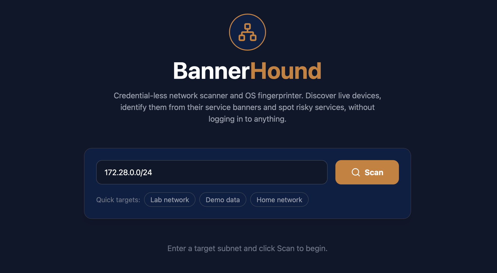
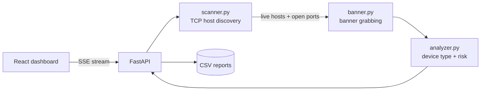

# BannerHound


**Credential-less network scanner and OS fingerprinter with live results and risk scoring.**

BannerHound discovers live devices on a subnet and identifies them (Cisco router, Ubuntu server, Nginx, legacy Telnet device...) by reading the banners their services announce, **without ever logging in**. Every device gets a risk level, and results stream to the dashboard in real time.



## ✨ Features

- **Credential-less fingerprinting**: reads SSH, HTTP, HTTPS and Telnet banners ("hit and run": connect, read, disconnect).
- **Fast**: parallel TCP discovery (100 threads) and parallel banner grabbing (30 threads). A /24 takes about ten seconds in the worst case.
- **Live results**: every host is pushed to the browser with Server-Sent Events as soon as it is fingerprinted, with a progress bar and a stop button.
- **Risk scoring**: each device gets a High, Medium, Low or Info level with the reason (cleartext Telnet, plain HTTP, outdated OpenSSH, SSH protocol 1...).
- **Dashboard**: search, risk filters, sortable columns, stats cards.
- **CSV export**: one report per scan, protected against CSV injection.
- **Safe by default**: private ranges only, subnet size limit, restricted CORS, non-root containers, ports bound to localhost.
- **Built-in lab**: a fake network of 5 devices, so anyone can try the project with one command.
- **Tested**: pytest suite, ruff, and a CI pipeline that also runs a Docker smoke test.

## 🧠 How it works



1. **Discovery**: `scanner.py` opens TCP connections to ports 22, 23, 80 and 443 on every IP of the subnet using a thread pool. A host with at least one open port is considered alive.
2. **Banner grabbing**: `banner.py` connects to the open services in parallel and reads what they announce (SSH identification string, HTTP `Server` header, Telnet greeting). No authentication is attempted.
3. **Analysis**: `analyzer.py` maps each banner to a device type with a rules table, and assigns a risk level.
4. **Streaming**: `main.py` sends each result to the browser as soon as it is ready and saves a CSV report at the end.

## 🚀 Quick start

### Option A: the lab (Docker, recommended)

```bash
git clone https://github.com/Djilali-77/BannerHound.git
cd BannerHound
docker compose -f docker-compose.yml -f docker-compose.lab.yml up --build -d
```

Open <http://localhost:5173> and scan `172.28.0.0/24`. You should see:

| IP | Device | Risk |
|---|---|---|
| 172.28.0.10 | Web Server (Nginx) | Medium |
| 172.28.0.11 | Web Server (Apache) | Medium |
| 172.28.0.20 | Linux Server (Ubuntu) | Low |
| 172.28.0.21 | Linux Server (Debian) | Low |
| 172.28.0.30 | Legacy Cisco/Router (Telnet) | High |

> On Linux, the Docker gateway `172.28.0.1` (your own machine) may also appear in the results if it runs an SSH server. That is expected.

Stop everything with:

```bash
docker compose -f docker-compose.yml -f docker-compose.lab.yml down
```

You can also scan the keyword `test` to get demo data without any network.

### Option B: scan your real network (run it natively)

> Docker Desktop on macOS and Windows runs containers inside a virtual machine, so they cannot see your physical network. To scan your own LAN, run the backend directly on your machine.

```bash
# Terminal 1: backend
cd backend
python -m venv venv
source venv/bin/activate        # Windows: venv\Scripts\activate
pip install -r requirements.txt
uvicorn main:app --reload

# Terminal 2: frontend
cd frontend
npm install
npm run dev
```

Then open <http://localhost:5173> and scan your subnet, for example `192.168.1.0/24`.

## ⚙️ Configuration

| Variable | Where | Default | Description |
|---|---|---|---|
| `CORS_ORIGINS` | backend | `http://localhost:5173,http://127.0.0.1:5173` | Browser origins allowed to call the API |
| `ALLOW_PUBLIC_SCAN` | backend | `false` | Set to `true` to allow scanning public IP ranges |
| `REPORTS_DIR` | backend | `backend/data/reports` | Where CSV reports are saved |
| `VITE_API_URL` | frontend | `http://localhost:8000` | Base URL of the API |

## 📡 API

Interactive documentation is available at <http://localhost:8000/docs>.

| Method | Endpoint | Description |
|---|---|---|
| GET | `/api/health` | Liveness check |
| GET | `/api/scan?subnet=` | Blocking scan, returns all results at once |
| GET | `/api/scan/stream?subnet=` | Live scan using Server-Sent Events |
| GET | `/api/download-report?scan_id=` | CSV report of a scan (latest one if `scan_id` is omitted) |

Events of the stream:

| Event | Payload | Meaning |
|---|---|---|
| `start` | `{scan_id}` | Scan accepted |
| `hosts` | `{total}` | Number of live hosts found |
| *(default)* | one result row | A host has been fingerprinted |
| `scan_error` | `{message}` | Invalid subnet or internal error |
| `close` | `{scan_id, total}` | Scan finished |

## 🚦 Risk levels

| Level | Examples |
|---|---|
| **High** | Telnet open (credentials in cleartext), SSH protocol 1 |
| **Medium** | Plain HTTP, OpenSSH older than 8.0 |
| **Low** | SSH 2 with a recent OpenSSH, HTTPS |
| **Info** | No banner or unrecognized service |

The risk level is a heuristic based on the protocol and the announced version. It is **not** a vulnerability scan.

## 📂 Project structure

```text
.
├── backend/
│   ├── main.py            # FastAPI app, SSE streaming, CSV reports
│   ├── scanner.py         # Multi-threaded TCP discovery and subnet validation
│   ├── banner.py          # Banner grabbing (SSH, HTTP, HTTPS, Telnet)
│   ├── analyzer.py        # Banner to device type and risk level
│   ├── tests/             # pytest suite
│   └── Dockerfile
├── frontend/
│   ├── src/
│   │   ├── components/    # UI components
│   │   ├── hooks/         # useScan: SSE client
│   │   ├── lib/           # API helpers and risk styles
│   │   └── config/        # External links
│   ├── nginx.conf
│   └── Dockerfile
├── lab/                   # Fake devices for the Docker lab
├── .github/workflows/     # CI pipeline
├── docker-compose.yml
└── docker-compose.lab.yml
```

## 🧪 Tests

```bash
cd backend
pip install -r requirements-dev.txt
pytest
ruff check .
```

The tests use local fake services (sockets and HTTP servers on `127.0.0.1`), so no real network is needed. The CI pipeline runs them on every push, builds the frontend, then starts the Docker lab and checks that all 5 fake devices are found.

## ⚠️ Limitations

- Fingerprinting from banners is a heuristic. Banners can be hidden or changed by the device owner.
- It is a TCP connect scan (no raw packets, no root privileges), limited to IPv4 and ports 22, 23, 80 and 443.
- The API has no authentication. Do not expose it to an untrusted network.

## 🗺️ Roadmap

- [ ] Custom port list and more services (FTP, SMTP, RDP)
- [ ] Match banner versions against known CVEs
- [ ] Scan history stored in SQLite
- [ ] JSON and PDF export
- [ ] Authentication and rate limiting
- [ ] Frontend tests

## ⚖️ Disclaimer

This tool is designed for **authorized network auditing and educational purposes only**. Only scan networks you own or have explicit permission to test.


🌐 **Portfolio:** https://portfolio-morvox.vercel.app
